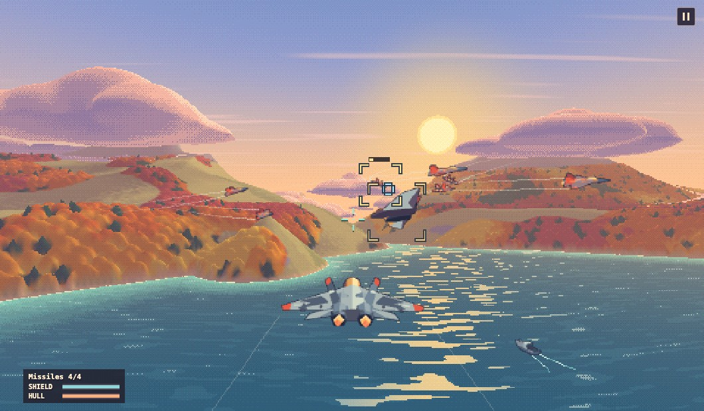
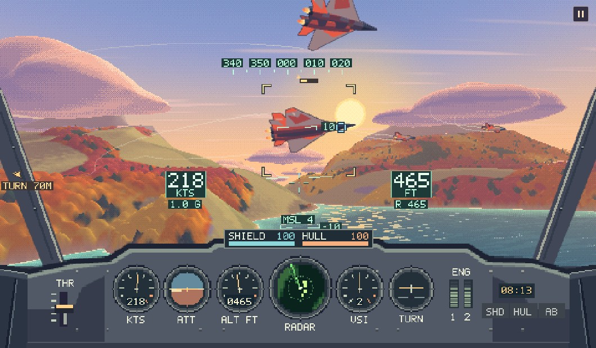
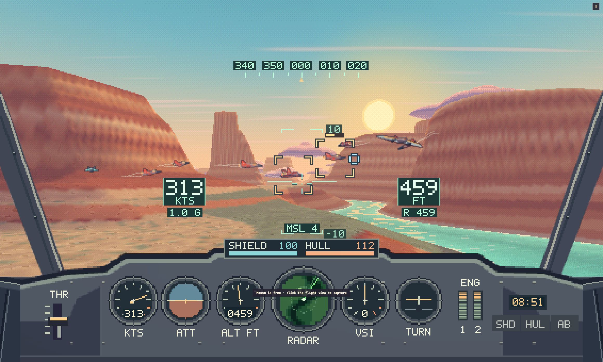
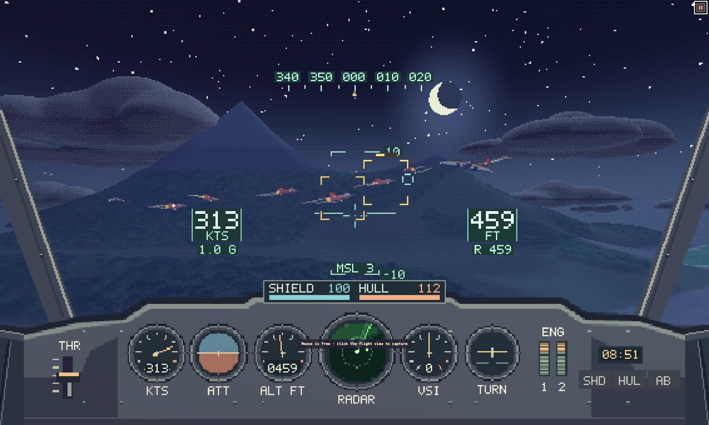
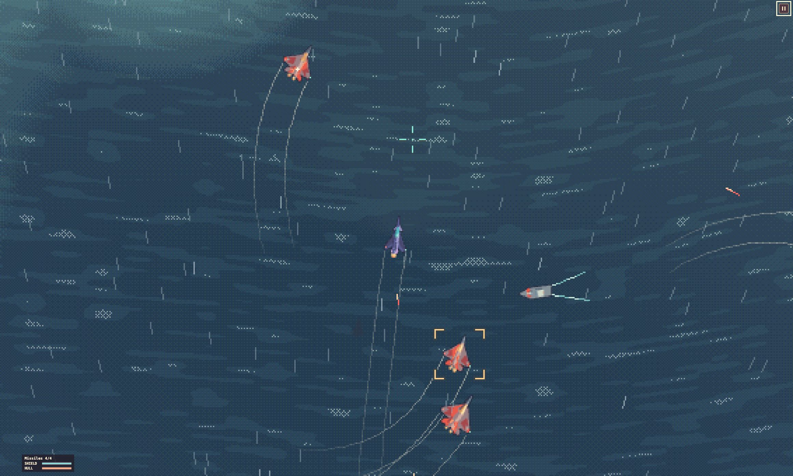

# 

Fly a pixel-art jet through autumn lake country, sandstone mesas, or a storm over Jade Isle. Break up enemy formations, choose upgrades between waves, and take on the carrier. Spend your flight credits in the hangar before your next run.

**[Play Splash One in your browser](https://dev.jdayers.com/splash-one/)** or open `index.html` locally in a WebGL2 browser.

| Chase view over the lake | Cockpit on approach |
| --- | --- |
|  |  |

| Painted Mesa | Jade Isle by moonlight | Storm patrol |
| --- | --- | --- |
|  |  |  |

## First flight

Choose Kestrel for a balanced cannon, Needle for a fast jet with a piercing lance, or Manta for armor and a scatter cannon. Difficulty 1 uses the original formations. Levels 2 and 3 add three and six aircraft per formation.

| Action | Desktop control |
| --- | --- |
| Steer and aim | Move the mouse |
| Fire primary weapon | Hold left mouse |
| Launch missile | Right mouse or F |
| Boost / brake | Hold Shift / S |
| Barrel roll | Q or E |
| Change view | Space |
| Pause | Esc or P |

On a phone, drag the thumbstick to steer and tap or hold the weapon buttons to fire. Open **Pause → Controls** to adjust steering or rebind desktop inputs.
